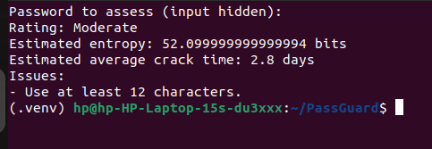
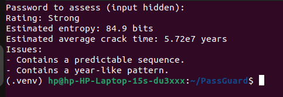
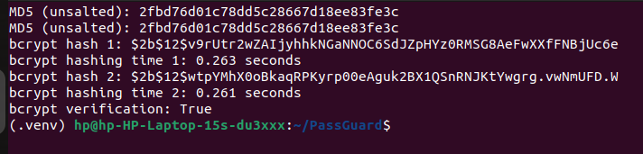

# PassGuard

[](https://github.com/vijjada/INTERNSHIP-TASK-6--ELEVATE-LABS/actions/workflows/security.yml)

PassGuard is a small educational password-analysis and hashing demo. It shows how password length and predictable patterns affect estimates, and why password storage should use a salted, adaptive hash rather than a fast general-purpose digest.

## OWASP Top 10 mapping

| Category | PassGuard coverage |
| --- | --- |
| A02: Cryptographic Failures | Compares an intentionally insecure MD5 example with bcrypt hashes using independent salts and cost 12. |
| A07: Identification and Authentication Failures | Flags short, common, repeated, sequential, and year-like password patterns to teach stronger authentication hygiene. |

PassGuard is a teaching tool, not an authentication service or a password-strength guarantee.

## Features

- Estimates entropy from the character classes present.
- Applies a simple penalty when high-entropy input contains predictable patterns.
- Accepts password input without echoing it to the terminal.
- Demonstrates bcrypt hashing and verification alongside a clearly labeled MD5 anti-pattern.
- Makes no network calls and does not store input.

## Run

Requires Python 3.12.

```bash
python3.12 -m venv .venv
source .venv/bin/activate
python -m pip install -r requirements.txt
pytest -q
python -m passguard.cli
python -m passguard.hashing_demo
```

## Screenshots

- TODO: Add a screenshot of the CLI analysis output.
- TODO: Add a screenshot of the hashing demonstration.

## Research

The original password-strength research report is included at [`docs/Password_Strength_Analysis_Task6_Report.pdf`](docs/Password_Strength_Analysis_Task6_Report.pdf). Password samples in the report have been redacted.

## Security notes

- PassGuard does not save or transmit entered passwords.
- The CLI hides typed input, but the password still exists briefly in process memory.
- The MD5 call is intentionally insecure and shown only for education; CI excludes that demo from Bandit.
- Entropy and crack-time values are rough estimates, not guarantees. They assume an offline fast-hash attack rate of 10 billion guesses per second.

## Disclaimer

For educational use only. Do not enter real, reused, or personal passwords.

## Demo Screenshots

### Password analysis: moderate result


### Password analysis: strong result with pattern warnings


### MD5 (insecure) vs bcrypt (secure)

